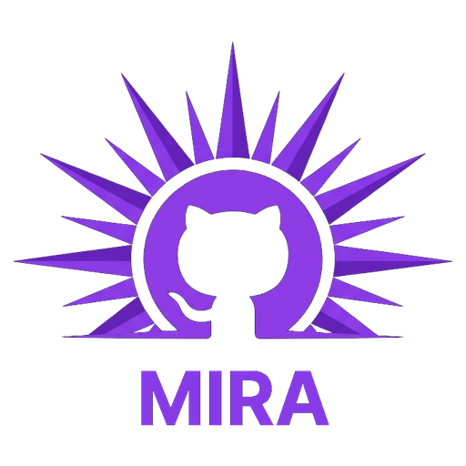

<p align="center"></p>

<p align="center"><a href="https://github.com/Stellatinus/Mira/actions/workflows/ci.yml"></a></p>

# Mira

Una dashboard per tenere sotto controllo GitHub da un unico posto, anche con più account.
La mattina la apri e vedi cosa richiede la tua attenzione, invece di scorrere le email.

Mira mostra, per tutti gli account collegati (con filtro per account):

- **Review richieste a te**: le PR che aspettano il tuo parere
- **Assegnate a te**: issue e PR di cui sei assegnatario
- **Issue**: tutte le issue aperte nei tuoi repository e organizzazioni (non solo le prime 100), con filtro di assegnazione (assegnate a te di default, ad altri, non assegnate) e per assegnatario
- **Notifiche non lette**: la casella di GitHub, ordinata e senza rumore
- **Menzioni**: dove qualcuno ti ha taggato
- **Le tue PR e issue aperte**
- **Repository** (con il logo del repository o l'avatar di chi lo possiede): una card per repository anche se lo vedono più account, con i preferiti dietro il pulsante «Mostra preferiti» (le regole sono in [`docs/REGOLE.md`](docs/REGOLE.md)), con ordinamento (aggiornamento, nome, stelle, PR, issue, cosa aspetta te) e filtri combinabili (attività: con PR o issue aperte, con issue non assegnate, aspettano te, senza nulla di aperto; visibilità; fork; preferiti; linguaggio; proprietario); ogni repository ha un
  doppio indicatore, uno per le PR (blu) e uno per le issue (arancio): il numero è quante ce ne sono di aperte
  nel repository (da GitHub, anche di altri); è pieno se tra queste qualcosa aspetta te (review richieste,
  assegnate, menzioni, notifiche non lette, su tutti gli account collegati), solo contorno altrimenti.
  Il pannello dettaglio ha una sezione per le PR e una per le issue: «31 aperte (3 tue)» (le tue sono quelle
  assegnate a te), le issue senza assegnatario, e cosa aspetta te; in più dice se il repository è un fork
- **Avvisi sui token**: quando un token sta per scadere o non è più valido

Il nome viene da *Mira*, la stella variabile nella costellazione della Balena (in latino «la meravigliosa»):
cambia luminosità nel tempo, come l'attività dei tuoi repository.

## Stack

- **Backend:** C# / ASP.NET Core (.NET 10), minimal API. Tiene i token, interroga GitHub, unisce i risultati.
- **Frontend:** React + TypeScript (Vite).
- Un solo processo: il backend serve anche il frontend compilato.

## Avvio

### Da una release

Dalla pagina delle [release](https://github.com/Stellatinus/Mira/releases) scarica il pacchetto per il tuo sistema (Windows o Linux), estrailo e avvia `Mira.Server`; poi apri <http://127.0.0.1:5080>. Non serve installare nulla. I programmi non sono firmati: Windows può mostrare un avviso la prima volta. Come si fanno le release: [`docs/RELEASING.md`](docs/RELEASING.md).

### Dal sorgente

Servono .NET 10 SDK e Node.js.

```bash
# 1. compila il frontend (finisce in src/Mira.Server/wwwroot)
cd web
npm install
npm run build
cd ..

# 2. avvia Mira
dotnet run --project src/Mira.Server
```

Poi apri <http://localhost:5080> e collega il tuo primo account.

### Sviluppo

Due terminali: backend con `dotnet run --project src/Mira.Server` (porta 5080) e frontend con
`cd web && npm run dev` (porta 5173, inoltra `/api` al backend).

## Collegare un account

Mira usa un **personal access token classic** per ogni account.

1. Accedi a GitHub con l'account da collegare e apri
   <https://github.com/settings/tokens/new?description=Mira&scopes=notifications,repo,read:org>
   (nome e permessi sono già compilati).
2. Controlla gli scope: `notifications`, `repo`, `read:org`.
3. Scegli una scadenza (consigliati 90 giorni). Mira ti avvisa 7 giorni prima.
4. Genera il token, copialo (GitHub lo mostra una sola volta) e incollalo nella pagina **Impostazioni**.
5. Se l'account fa parte di organizzazioni con SAML SSO, usa «Configure SSO» accanto al token per autorizzarle.

Servono token *classic*: i token fine-grained non danno accesso alle notifiche. Per collegare più account
ripeti i passi accedendo ogni volta con l'account giusto.

## Avvisi del sistema

Dalle **Impostazioni → Avvisi del sistema** si può chiedere a Mira di mandare una **notifica del browser** quando arriva una **menzione** o una **review richiesta**, scegliendo quali. Sono **spenti di default**; attivandoli il browser chiede il permesso (solo allora). Mira avvisa solo quando è aperta ma **non la stai guardando** (scheda in secondo piano o finestra senza focus), e solo per ciò che è comparso dall'ultimo aggiornamento: non avvisa di quello che c'era già, né di ciò che hai segnato come visto. Cliccando l'avviso si apre la vista giusta.

## Aggiornamenti

All'apertura Mira chiede a GitHub, **senza token**, qual è l'ultima release del progetto e la confronta con la propria versione (`MAJOR.MINOR.PATCH`, vedi [`docs/RELEASING.md`](docs/RELEASING.md)). Se ce n'è una più nuova lo dice con un avviso (che si chiude, e non ricompare per la stessa versione) e nelle **Impostazioni → Informazioni**, con il link alle note di rilascio. **Non scarica né installa nulla**: per aggiornare si scarica il pacchetto dalla pagina delle release.

Il controllo si spegne dalle Impostazioni («Controlla gli aggiornamenti all'apertura»); «Controlla ora» lo fa a richiesta. Una versione compilata dal sorgente (`0.0.0-dev`) non ha niente da controllare; una versione di prova (`1.3.0-rc.1`) viene avvisata della stabile che la segue, ma le pre-release non si propongono a chi ha una stabile.

## Tema e lingua

Dalle **Impostazioni** (il pulsante `•••` sopra gli avatar, in basso a sinistra) si sceglie il tema
(Sistema, Scuro, Chiaro), la lingua dell'interfaccia (Italiano, English) e ogni quanto Mira si aggiorna da
sola (mai, 5, 10, 15, 30 minuti o 1 ora; di default 5). Non si scende sotto i 5 minuti perché la Search API di
GitHub concede 30 richieste al minuto per utente. Le scelte restano nel browser.

Il backend non scrive frasi per l'utente: manda codici (`token-invalid`, `missing-scope:repo`…) che il frontend
traduce. Per **aggiungere una lingua**:

1. copia `web/src/i18n/it.ts` in `web/src/i18n/xx.ts` e traduci i valori, lasciando uguali le chiavi
   (il tipo `Messages` fa fallire la compilazione se ne manca una);
2. aggiungi una riga a `LANGUAGES` in `web/src/i18n/languages.ts`.

La nuova lingua compare da sola nell'elenco delle Impostazioni; date e tempi relativi seguono il suo `locale`.

## Dati salvati

Per mostrare subito qualcosa all'apertura, Mira salva nel browser l'ultima fotografia dei dati e la mostra mentre scarica quelli nuovi da GitHub (in alto compare «Dati salvati 3 ore fa · aggiorno…»). Sono nello storage locale del browser, non nei cookie. Contengono titoli di issue e PR, anche dei repository privati, ma **mai i token**, e restano su questo computer. Dalle Impostazioni si possono cancellare; si risalvano all'aggiornamento successivo.

## Elementi visti

Dal pannello dei dettagli si può segnare un elemento come **visto** o **rimandarlo a domani**: sparisce dall'elenco finché non cambia (o fino alle 8 di domani) e il pulsante «Mostra già visti» lo riporta in vista. Non tocca GitHub: lo stato è nel file `seen.json` della cartella di configurazione (non cifrato, solo indirizzi e date). Le regole sono in [`docs/REGOLE.md`](docs/REGOLE.md).

## Dove stanno i token

- In un file cifrato (AES-GCM) nella cartella di configurazione dell'utente, fuori dal repository:
  Windows `%APPDATA%\Mira`, Linux/macOS `~/.config/Mira`. Stessa regola su tutti i sistemi.
- Il file è leggibile solo dal tuo utente. La chiave si genera al primo avvio (`master.key`), oppure puoi
  fornirla tu con la variabile `MIRA_MASTER_KEY` (32 byte in base64), così non sta accanto ai token.
- I token non arrivano mai al browser.
- Questo protegge da perdite accidentali (commit, backup, condivisioni), **non** da un programma malevolo
  che gira con il tuo stesso utente. Il portachiavi di sistema è nella roadmap.
- Il server ascolta solo su `127.0.0.1` e rifiuta richieste che non arrivano da localhost.

Variabili d'ambiente: `MIRA_URLS` (default `http://127.0.0.1:5080`), `MIRA_DATA_DIR`, `MIRA_MASTER_KEY`.

## Roadmap

- [ ] Stato di review delle tue PR (approvata, modifiche richieste, nuovi commenti) tramite GraphQL
- [ ] Nuove release dei repository che segui
- [ ] Novità sulle issue che hai aperto
- [ ] Portachiavi di sistema (Credential Manager, Keychain, libsecret) come archivio alternativo
- [ ] Accesso con GitHub (OAuth) in aggiunta ai token
